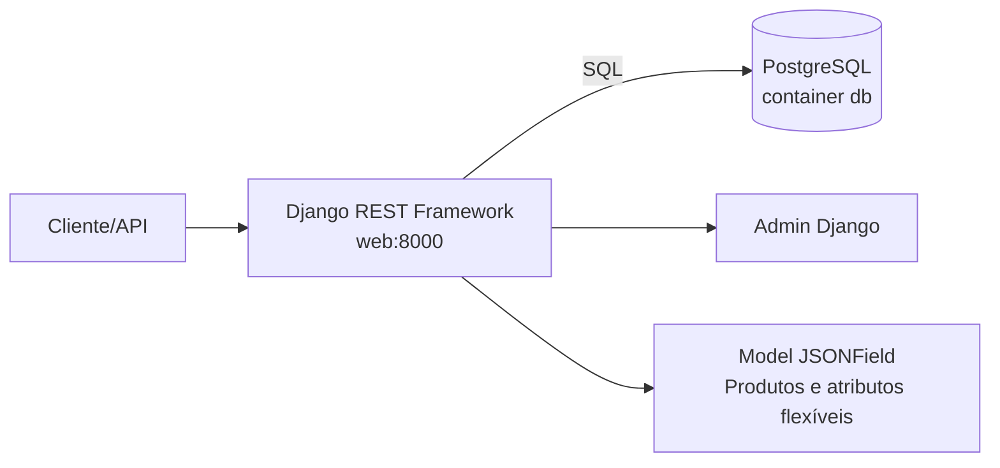

# ZuumPay - API de pagamentos multimodelo

Projeto acadêmico de cloud e arquitetura de software que evolui o app Django para uma stack compatível com EC2 + Docker Compose + PostgreSQL, com dados relacionais e semiestruturados.

## Links
- API publicada: `http://<IP-PUBLICO>:8000/api/`
- Site MkDocs: `https://projetos-de-extensao.github.io/PC_CDIA_26.2_8001_III/`
- Repositório: `https://github.com/Projetos-de-Extensao/PC_CDIA_26.2_8001_III`

## Arquitetura da solução



## Visão do projeto
A aplicação expõe um domínio de pagamentos com lojistas, lojas, categorias, produtos e transações. O modelo documental usa um `JSONField` em `Produto.atributos` e um índice GIN para consulta por atributos semiestruturados; o fluxo de transações grava dados em múltiplas tabelas em uma única transação atômica.

## Stack
- Python 3.12
- Django 6.0.4
- Django REST Framework 3.17.1
- PostgreSQL 16
- Docker + Docker Compose
- MkDocs + Material

## Execução local

1. Crie e ative o ambiente virtual:

```powershell
python -m venv .venv
.\.venv\Scripts\Activate.ps1
```

2. Instale dependências do projeto:

```powershell
python -m pip install --upgrade pip
python -m pip install -r .\scr\DeployEB\requirements.txt
```

3. Configure as variáveis de ambiente:

```powershell
Copy-Item .\scr\DeployEB\.env.example .\scr\DeployEB\.env
```

Edite o arquivo `.env` com chaves reais, incluindo `DJANGO_SECRET_KEY` e as credenciais PostgreSQL.

4. Execute as migrações e carregue os dados de exemplo:

```powershell
cd .\scr\DeployEB
python manage.py migrate
python manage.py seed_demo
python manage.py createsuperuser
python manage.py runserver 0.0.0.0:8000
```

A API está disponível em `http://127.0.0.1:8000/api/`.

## Execução com Docker Compose

```powershell
cd .\scr\DeployEB
Copy-Item .env.example .env
docker compose up -d --build
```

Verifique a saúde do serviço com:

```powershell
docker compose ps
docker compose logs -f web
docker compose logs -f db
```

## Deploy na EC2

Fluxo recomendado:

1. Instale Git, Docker e Docker Compose na instância EC2.
2. Configure o Security Group liberando apenas SSH (22) e a porta da API (80 ou 8000).
3. Faça clone do repositório e copie `.env.example` para `.env` com os segredos reais.
4. Rode:

```bash
git pull
cd /home/ec2-user/PC_CDIA_26.2_8001_III/scr/DeployEB
docker compose up -d --build
```

5. Execute migrações e a criação do superusuário no container, se necessário:

```bash
docker compose exec web python manage.py migrate
docker compose exec web python manage.py createsuperuser
```

## Endpoints principais
- `GET /api/` — informações gerais da API
- `GET /api/lojistas/` — lista lojistas
- `GET /api/lojas/` — lista lojas
- `GET /api/categorias/` — lista categorias
- `GET /api/produtos/` — lista produtos, com filtro por JSON via `?atributos__chave=tipo&atributos__valor=sensor`. No PostgreSQL, o filtro usa containment JSONB (`@>`) no banco e o índice GIN de `Produto.atributos`, antes da paginação. Valores escalares podem ser enviados como JSON (`true`, `false`, `12`, `"sensor"`); texto sem aspas também é tratado como string.
- `GET /api/transacoes/` — lista transações
- `POST /api/transacoes/<id>/aprovar/` — aprova transação pendente
- `POST /api/transacoes/<id>/cancelar/` — cancela transação pendente
- `GET /admin/` — administração do Django

## Evidências de persistência e deploy
- `docker compose ps` deve listar os serviços `web` e `db` em execução.
- `docker compose logs` deve indicar a aplicação em execução e a conexão com PostgreSQL.
- A API deve responder com status HTTP 200 em `/api/` e a interface administrativa em `/admin/`.
- Reiniciar os containers e verificar que os dados continuam persistidos no volume Docker do PostgreSQL é o requisito de persistência do projeto.

## Documentação
A documentação da fase de iniciação e elaboração está em `docs/` e publicada pelo MkDocs em GitHub Pages.

## Requisitos atendidos
- A1: app e projeto em contexto de pagamentos e cloud
- A2: 4+ models relacionais com ForeignKey e ManyToMany
- A3: `Produto.atributos` com JSONField e GIN index
- A4: transação em `transaction.atomic()` com rollback
- A5: CRUD DRF, filtros JSON e endpoints
- A6: Admin Django funcional
- A7: variáveis de ambiente e `.env`
- A8: seed de dados demo
- B2/B3/B4/B5/B6/B7/B8: arquitetura e deploy descritos para Docker + Postgres + EC2

## Deploy em Produção (AWS EC2 + Docker Compose + PostgreSQL)

A aplicação foi migrada do Elastic Beanstalk (com SQLite) para uma arquitetura containerizada em execução em uma instância **AWS EC2 (Amazon Linux 2023)**, orquestrada via **Docker Compose** com banco de dados relacional/multimodelo **PostgreSQL 16** persistido em volume Docker.

### Links da Entrega
* **API em Produção (AWS EC2):** `http://16.59.23.184:8000/api/`
* **Painel Administrativo (Django Admin):** `http://16.59.23.184:8000/admin/`
* **Documentação do Projeto (MkDocs / GitHub Pages):** `https://projetos-de-extensao.github.io/PC_CDIA_26.2_8001_III/`

---

### Arquitetura e Infraestrutura
* **Servidor Cloud:** Instância AWS EC2 (`us-east-2`), IP Público `16.59.23.184`, com regras de entrada configuradas no Security Group para **SSH (porta 22)** e **HTTP/API (porta 8000)**.
* **Containers (`docker-compose.yml`):**
  * `zuumpay-web`: Aplicação Django + Django REST Framework (`python:3.12-slim`), conectada ao banco via variáveis de ambiente (`.env`).
  * `zuumpay-db`: Banco de dados `postgres:16-alpine` com healthcheck (`pg_isready`) e persistência garantida pelo volume nomeado `deployeb_postgres_data`.

---

### Como Executar Localmente ou na EC2

1. **Clonar o repositório e acessar o diretório de deploy:**
   ```bash
   git clone [https://github.com/projetos-de-extensao/pc_cdia_26.2_8001_iii.git](https://github.com/projetos-de-extensao/pc_cdia_26.2_8001_iii.git)
   cd pc_cdia_26.2_8001_iii/scr/DeployEB
