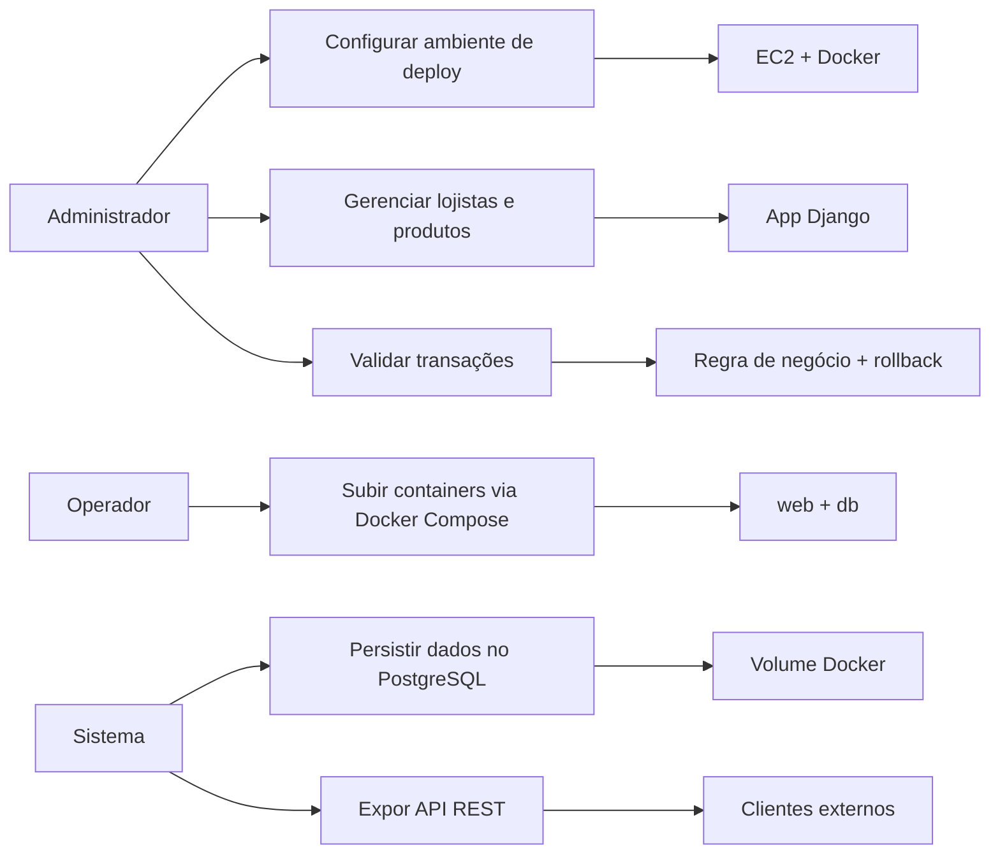
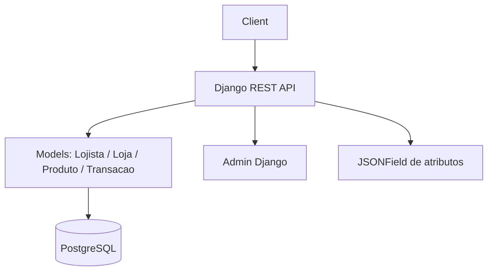

# Casos de Uso Arquiteturais — ZuumPay

## 1. Objetivo
Este documento descreve os casos de uso arquiteturais da aplicação ZuumPay, focando em implantação, persistência, segurança e operação.

## 2. Atores
- Administrador da plataforma
- Analista/operador de infraestrutura
- Desenvolvedor back-end
- Sistema de banco de dados

## 3. Casos de uso principais

## 4. Matriz de rastreamento

| Caso de uso | Requisito | Componente | Evidência |
|---|---|---|---|
| Configurar ambiente de deploy | B1/B2/B4 | EC2 + Docker + `.env` | `docker-compose.yml` + `.env.example` |
| Gerenciar lojistas e produtos | A1/A2/A5 | Django admin + API | Models e serializers |
| Validar transações | A4 | `transaction.atomic()` | endpoint de criação/aprovação |
| Persistir dados | A7/B2/B7 | PostgreSQL + volume | configuração do Compose |
| Consultar atributos flexíveis | A3/A5 | `Produto.atributos` + GIN | filtro em `ProdutoViewSet` |

## 5. Arquitetura em visão lógica

## 6. Observações
Os casos de uso arquiteturais evidenciam a escolha da arquitetura de aplicação em camadas, com persistência em banco relacional e flexibilidade semiestruturada para atributos de produto. Esse desenho minimiza o risco de mudança de domínio e atende aos requisitos de API, deploy e documentação do projeto.
