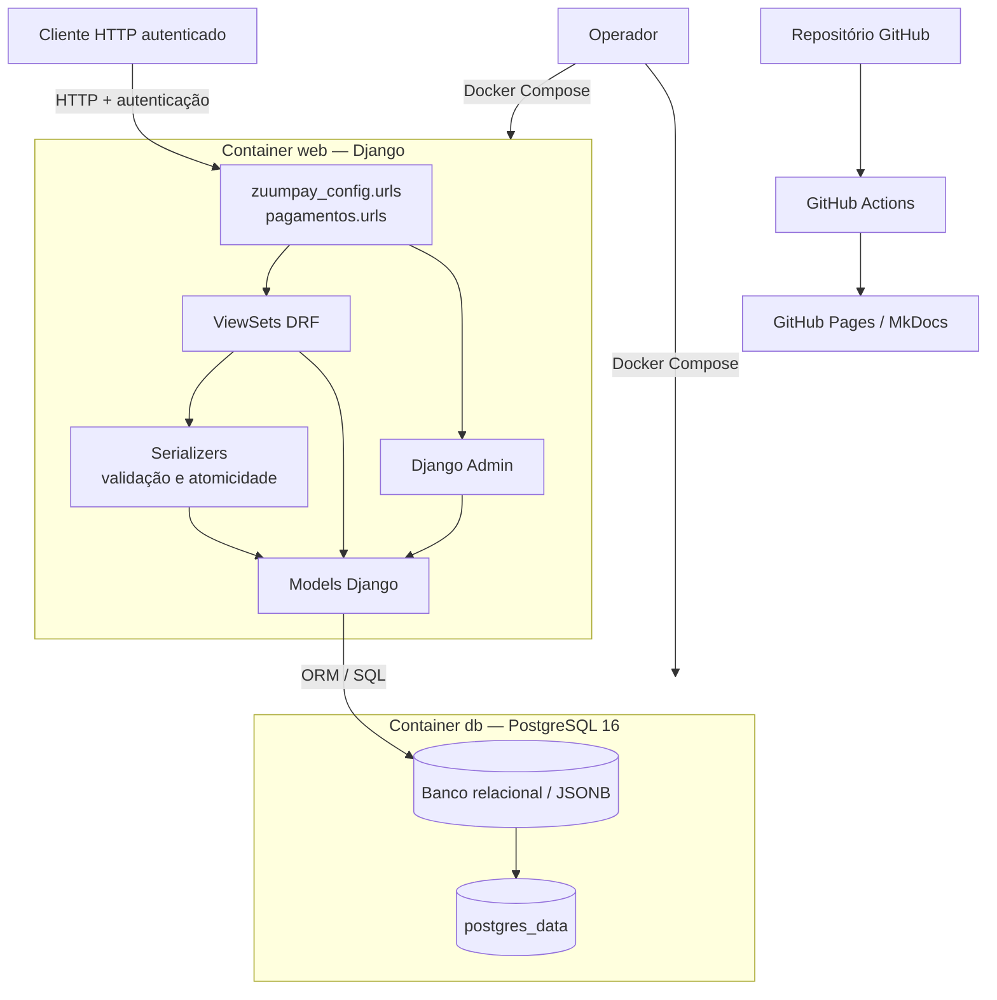

# Diagrama de Componentes — ZuumPay

## 1. Visão dos módulos

O componente web concentra a API DRF e o painel Django. As views delegam validações e criação aninhada ao serializer; os models representam o domínio e são persistidos pelo backend PostgreSQL. O Compose coordena os containers, enquanto GitHub Actions constrói e publica a documentação separadamente.

## 2. Interfaces entre componentes

| Origem | Destino | Interface / protocolo | Observação |
|---|---|---|---|
| Cliente HTTP | ViewSets DRF | HTTP/JSON, Basic ou Session Authentication | Viewsets exigem autenticação; raiz de descoberta é pública |
| URL dispatcher | API e Admin | Roteamento Django | `/api/` e `/admin/` |
| ViewSet | Serializer | Chamadas internas Python/DRF | Validação de entrada e representação da resposta |
| Serializer/ViewSet | Models | ORM Django | `transaction.atomic()` na criação de transações com itens |
| Models | PostgreSQL | Driver PostgreSQL, rede interna Compose | JSONField é armazenado como JSONB pelo backend PostgreSQL |
| PostgreSQL | Volume Docker | Persistência do diretório de dados | Volume nomeado `postgres_data` |
| GitHub Actions | GitHub Pages | Artifact de Pages e OIDC | Workflow em `.github/workflows/deploy-docs.yml` |

## 3. Restrições do desenho

- O Compose atual é voltado à demonstração: usa `runserver` e monta o diretório da aplicação. Não se deve descrever essa configuração como topologia de produção endurecida.
- O PostgreSQL não publica uma porta no host e depende do serviço `web` na rede privada do Compose.
- Não há proxy HTTPS, balanceador, réplica, monitoramento contínuo nem backup automatizado configurados no repositório.
- Para detalhamento de entidades/relacionamentos, consulte o [modelo relacional](dimrbd.md). Para o caminho de criação e aprovação de transação, consulte a [sequência de comunicação](seq_com.md).

## 4. Histórico e aprovação

Versão 1.0, preparada em 2026-11-13; aprovação do orientador/avaliador pendente. Consulte o [histórico consolidado](index.md#historico-de-versoes-e-aprovacoes).
