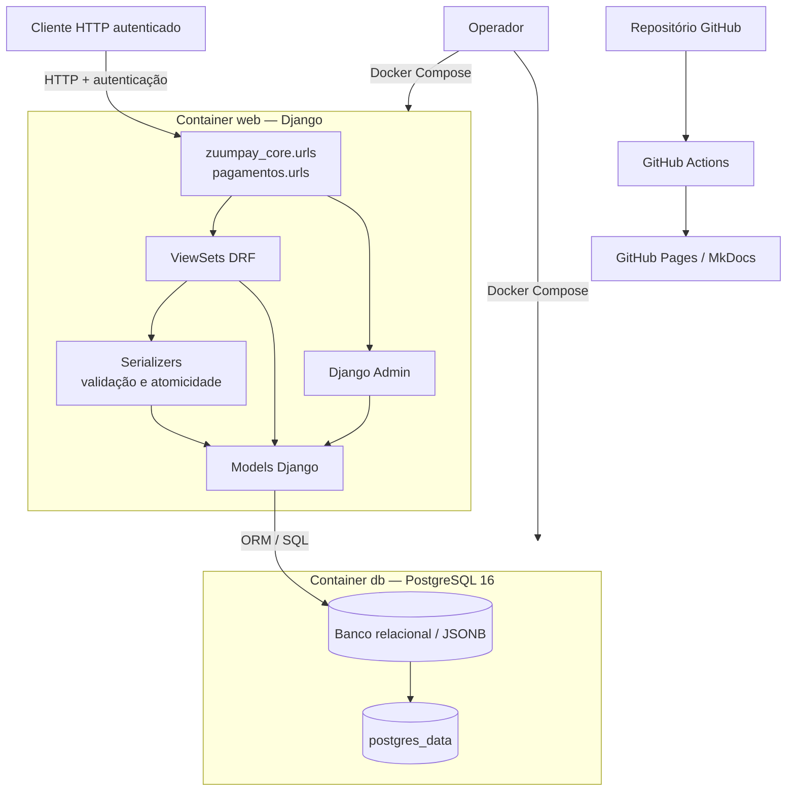
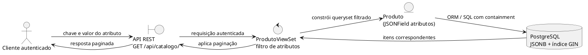

# Diagrama de Componentes — ZuumPay

## 1. Visão dos módulos

O componente web concentra a API DRF e o painel Django. As views delegam validações e criação aninhada ao serializer; os models representam o domínio e são persistidos pelo backend PostgreSQL. O Compose coordena os containers, enquanto GitHub Actions constrói e publica a documentação separadamente.

## 2. Interfaces entre componentes

| Origem | Destino | Interface / protocolo | Observação |
|---|---|---|---|
| Cliente HTTP | ViewSets DRF | HTTP/JSON, Basic ou Session Authentication | Viewsets exigem autenticação; raiz de descoberta é pública |
| URL dispatcher | API e Admin | Roteamento Django | `/api/` e `/admin/` |
| ViewSet | Serializer | Chamadas internas Python/DRF | Validação de entrada e representação da resposta |
| Serializer/ViewSet | Models | ORM Django | `transaction.atomic()` na criação de transações com itens |
| Models | PostgreSQL | Driver PostgreSQL, rede interna Compose | JSONField é armazenado como JSONB pelo backend PostgreSQL |
| PostgreSQL | Volume Docker | Persistência do diretório de dados | Volume nomeado `postgres_data` |
| GitHub Actions | GitHub Pages | Artifact de Pages e OIDC | Workflow em `.github/workflows/deploy-docs.yml` |

## 3. Restrições do desenho

- O Compose atual é voltado à demonstração: inicia Gunicorn, mas monta o diretório da aplicação e não configura proxy HTTPS nem limites de recursos. Não se deve descrever essa configuração como topologia de produção endurecida.
- O PostgreSQL não publica uma porta no host e depende do serviço `web` na rede privada do Compose.
- Não há proxy HTTPS, balanceador, réplica, monitoramento contínuo nem backup automatizado configurados no repositório.
- Para detalhamento de entidades/relacionamentos, consulte o [modelo relacional](dimrbd.md). Para o caminho de criação e aprovação de transação, consulte a [sequência de comunicação](seq_com.md).

## 4. Dimensionamento de computação (EC2)

### Premissas e capacidade

Para a demonstração de baixo tráfego, considera-se como cenário de referência uma instância EC2 `t3.small` com 2 vCPU e 2 GiB de memória, executando o container web e o PostgreSQL. É uma escolha inicial de baixo custo, não um resultado de teste de carga nem uma garantia de capacidade. A classe T é burstable; desempenho sustentado depende dos créditos de CPU e do perfil de uso.

| Componente | Recursos e uso esperado | Premissa de dimensionamento |
|---|---|---|
| Sistema operacional, Docker e serviços auxiliares | Memória e CPU compartilhadas | Reservar aproximadamente 0,5 GiB para o sistema e os containers auxiliares |
| Django + Gunicorn (`web`) | API, admin e processamento de requisições | Um worker síncrono como ponto de partida, ajustado após medir consumo e latência |
| PostgreSQL (`db`) | Consultas relacionais, JSONB, índices e cache | Memória compartilhada com o web; manter margem para conexões e cache do banco |
| EBS | Imagem de sistema, imagens Docker, aplicação, dados e logs | O orçamento do projeto considera 20 GB gp3; confirmar o volume realmente provisionado antes do deploy |

O limite de 2 GiB exige controlar o número de workers e conexões. Antes de aumentar tráfego ou volume, medir CPU, memória, latência e créditos de CPU; se houver pressão persistente, redimensionar a instância ou separar o banco em RDS. Os valores de memória por processo devem ser observados no ambiente real, não tratados como medição já realizada.

### Classes de análise

O diagrama a seguir representa a consulta de itens do catálogo por atributos semiestruturados no PostgreSQL.

## 5. Histórico e aprovação

Baseline 1.0 aprovada pela Equipe ZuumPay em 2026-11-13; aprovação do orientador/avaliador pendente. Consulte o [histórico consolidado](index.md#historico-de-versoes-e-aprovacoes).
