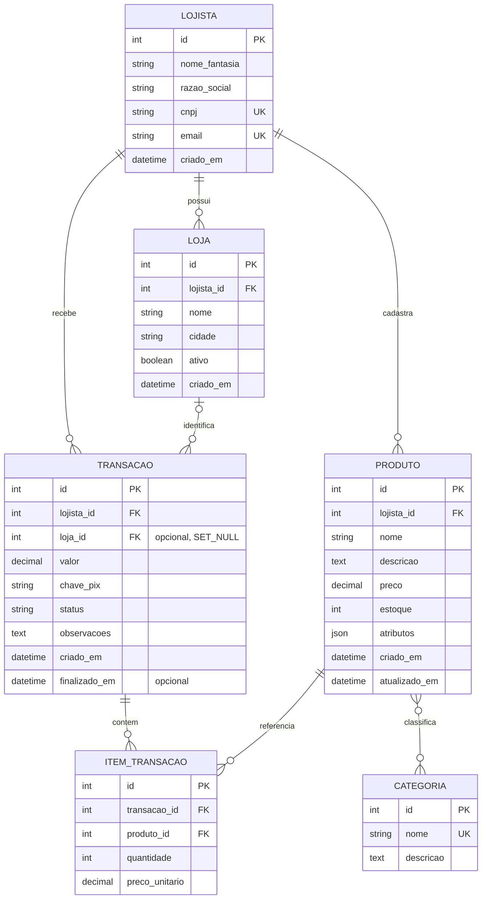

# Modelo Relacional do Banco de Dados — ZuumPay

## 1. Diagrama de entidades e relacionamentos

O desenho abaixo reflete os models Django. As cardinalidades representam os relacionamentos persistidos; `loja` é opcional em uma transação e pode ser definida como nula quando a loja é removida.



## 2. Regras e integridade

| Entidade/regra | Implementação |
|---|---|
| Lojista | CNPJ e e-mail únicos |
| Loja | FK obrigatória para lojista; remoção do lojista remove suas lojas (`CASCADE`) |
| Categoria | Nome único; relacionamento muitos-para-muitos com produtos |
| Produto | FK para lojista; `atributos` é objeto JSON; preço positivo e estoque não negativo |
| Índice de atributos | `GinIndex` em `Produto.atributos`, usado para consultas de containment no PostgreSQL |
| Transação | FK obrigatória para lojista; FK opcional de loja com `SET_NULL`; valor positivo |
| Item de transação | FKs para transação e produto; quantidade e preço unitário positivos; produto protegido contra remoção (`PROTECT`) |
| Consistência dos itens | Criação atômica valida lista vazia explícita, duplicidade, quantidade positiva, lojista do produto e soma a partir do preço oficial; payload legado sem a propriedade `itens` permanece aceito |
| Estoque flexível | `atributos` é objeto JSON; `estoque`, se presente, deve ser inteiro não negativo. Criação bloqueia produtos, debita saldo e cancelamento de transação pendente estorna saldo |
| Status da transação | Somente `PENDENTE -> PAGO` e `PENDENTE -> CANCELADO`; `PAGO` e `CANCELADO` são terminais. Finalização e atualização de transação usam `transaction.atomic()` e `select_for_update()` |

Produtos são associados a `Lojista`, não diretamente a `Loja`; sem alteração do modelo, o isolamento de itens é validado pelo lojista que possui a loja vinculada. O domínio representa pagamentos simulados e não efetua processamento financeiro real.

## 3. Migrações e armazenamento

As entidades são definidas em `scr/DeployEB/pagamentos/models.py`; a estrutura evolui pelas migrações em `scr/DeployEB/pagamentos/migrations/`. Em PostgreSQL, o `JSONField` usa o armazenamento JSONB do backend e o índice GIN é criado pela migração correspondente. No ambiente Compose, os arquivos do banco ficam no volume nomeado `postgres_data`; remover esse volume pode apagar os dados.

## 4. Memória de cálculo de volumetria e crescimento (12 meses)

Estimativa preliminar para dimensionamento, não uma medição do banco atual. Os tamanhos médios variam com o conteúdo de `atributos`, quantidade de itens por transação, índices, autovacuum e retenção de WAL.

| Grupo de dados | Premissa | Estimativa |
|---|---:|---:|
| Lojista, loja e categoria | 600 bytes × 2.000 registros | 1,2 MB |
| Produto relacional, JSONB e índice GIN | 2 KB × 50.000 produtos | 100 MB |
| Transação e itens | 1,5 KB × 200.000 transações/ano | 300 MB |
| Margem aproximada para índices e operação | Cerca de 30% sobre 401,2 MB | 120,4 MB |
| **Total estimado no primeiro ano** | 401,2 MB + 120,4 MB | **aprox. 521,6 MB** |

O cálculo supõe aproximadamente 200 mil transações no primeiro ano e já agrega transação/itens em uma média por operação; crescimento futuro deve ser recalculado com dados observados. WAL é variável e transitório, portanto não deve ser interpretado como espaço fixo garantido por esse percentual. O volume EBS gp3 de 20 GB é a premissa do cenário de custo descrito nos requisitos suplementares, não uma confirmação de que esse tamanho está provisionado na instância. Ainda assim, a projeção inicial fica abaixo dessa capacidade, mas imagens Docker, logs, backups e crescimento também consomem espaço.

## 5. Procedimento de backup e restauração

Os comandos abaixo são para Bash/Linux no diretório que contém o `docker-compose.yml`. O dump é escrito no host e usa as credenciais já injetadas no container pelo Compose. Armazene o arquivo de backup fora da instância/volume de produção, com acesso restrito; um dump na própria EC2 não protege contra perda do host.

**Backup lógico:**

```bash
docker compose exec -T db sh -c 'pg_dump -U "$POSTGRES_USER" "$POSTGRES_DB"' > backup_zuumpay.sql
```

**Restauração no banco configurado pelo Compose:**

```bash
docker compose exec -T db sh -c 'psql -U "$POSTGRES_USER" -d "$POSTGRES_DB"' < backup_zuumpay.sql
```

A restauração deve ser testada em um banco/ambiente controlado antes de substituir dados existentes. O procedimento atual é manual; não há agendamento, cópia externa automatizada nem RTO/RPO formal configurado no repositório.

## 6. Comparativo: volume Docker em EC2 vs. AWS RDS

| Critério | PostgreSQL em container e volume Docker na EC2 | AWS RDS for PostgreSQL |
|---|---|---|
| Custo | Sem tarifa de serviço de banco separada, mas consome recursos da EC2 e EBS; snapshots e armazenamento adicional podem gerar custo | Serviço e armazenamento cobrados separadamente; o total depende da classe, região, armazenamento, backups e disponibilidade. Consultar a AWS Pricing Calculator |
| Segurança de rede | Banco acessível pela rede interna do Compose; a configuração atual não publica a porta 5432 no host | Pode ser isolado em sub-redes privadas e controlado por Security Groups |
| Backups e manutenção | Operação manual de `pg_dump`, atualizações e snapshots do EBS | Backups automatizados e atualizações gerenciadas conforme configuração e limites do serviço |
| Disponibilidade | Ponto único de falha associado à instância e ao volume EBS | Opções de alta disponibilidade, incluindo Multi-AZ, conforme configuração e custo |
| Operação | Mais controle e menor complexidade de serviços para a demonstração, com maior responsabilidade operacional da equipe | Menos tarefas de operação do banco, em troca de custo e configuração próprios do serviço |
| Escolha neste projeto | **Adotado** para atender ao escopo acadêmico de EC2 + Docker Compose; não representa backup ou alta disponibilidade | Alternativa para uma evolução que exija gestão de banco e disponibilidade superiores |

As características e os custos dependem da região, classe e configuração contratadas. O projeto não afirma uma cotação fixa de RDS nem que Multi-AZ esteja habilitado.

## 7. Histórico e aprovação

Baseline 1.0 aprovada pela Equipe ZuumPay em 2026-11-13; aprovação do orientador/avaliador pendente. Consulte o [histórico consolidado](index.md#historico-de-versoes-e-aprovacoes).
