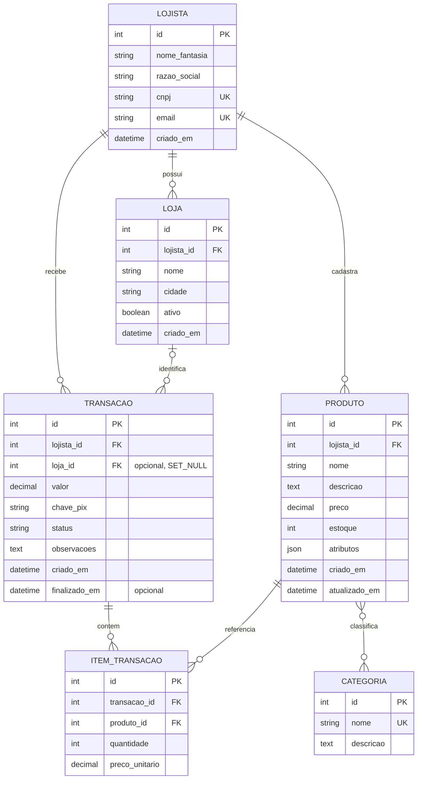

# Modelo Relacional do Banco de Dados — ZuumPay

## 1. Diagrama de entidades e relacionamentos

O desenho abaixo reflete os models Django. As cardinalidades representam os relacionamentos persistidos; `loja` é opcional em uma transação e pode ser definida como nula quando a loja é removida.

## 2. Regras e integridade

| Entidade/regra | Implementação |
|---|---|
| Lojista | CNPJ e e-mail únicos |
| Loja | FK obrigatória para lojista; remoção do lojista remove suas lojas (`CASCADE`) |
| Categoria | Nome único; relacionamento muitos-para-muitos com produtos |
| Produto | FK para lojista; `atributos` é objeto JSON; preço positivo e estoque não negativo |
| Índice de atributos | `GinIndex` em `Produto.atributos`, usado para consultas de containment no PostgreSQL |
| Transação | FK obrigatória para lojista; FK opcional de loja com `SET_NULL`; valor positivo |
| Item de transação | FKs para transação e produto; quantidade e preço unitário positivos; produto protegido contra remoção (`PROTECT`) |
| Consistência dos itens | Serializer exige que os produtos sejam do lojista da transação e, havendo itens, que a soma coincida com o valor; gravação ocorre em `transaction.atomic()` |
| Status da transação | `PENDENTE`, `PAGO` ou `CANCELADO`; apenas pendentes podem ser finalizadas pela ação correspondente |

O saldo/estoque não é debitado pelo fluxo de transação atual. O domínio representa uma simulação de pagamentos e não efetua processamento financeiro real.

## 3. Migrações e armazenamento

As entidades são definidas em `scr/DeployEB/pagamentos/models.py`; a estrutura evolui pelas migrações em `scr/DeployEB/pagamentos/migrations/`. Em PostgreSQL, o `JSONField` usa o armazenamento JSONB do backend e o índice GIN é criado pela migração correspondente. No ambiente Compose, os arquivos do banco ficam no volume nomeado `postgres_data`; remover esse volume pode apagar os dados.

## 4. Histórico e aprovação

Versão 1.0, preparada em 2026-11-13; aprovação do orientador/avaliador pendente. Consulte o [histórico consolidado](index.md#historico-de-versoes-e-aprovacoes).
