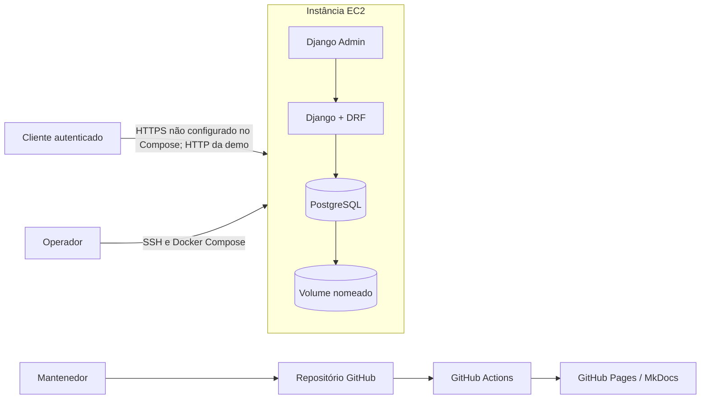

# Mapa de arquitetura e matriz de rastreamento — ZuumPay

## 1. Limites e contexto

O ZuumPay é uma aplicação acadêmica em uma única instância EC2: Django REST Framework atende a API e o painel administrativo; PostgreSQL roda em container separado e persiste em volume Docker. Não há processador de pagamentos real, balanceador, réplica de banco ou serviço de backup automatizado configurado no repositório.

O cliente da API precisa autenticar-se nos viewsets; o endpoint raiz de descoberta e o health check `/` são públicos. O banco só é acessado pelo serviço web na rede interna do Compose.

## 2. Componentes e conectores

| ID | Componente | Responsabilidade | Implementação |
|---|---|---|---|
| C-01 | Cliente/operador | Enviar chamadas autenticadas ou operar a instância | Cliente HTTP, SSH e Docker Compose |
| C-02 | Roteamento e API REST | Publicar endpoints, autenticação e ações de recursos | `zuumpay_config/urls.py`, `pagamentos/urls.py`, viewsets |
| C-03 | Serialização e regras | Validar payloads, persistir itens atomicamente e validar transições | `pagamentos/serializers.py`, `pagamentos/views.py` |
| C-04 | Domínio e persistência | Mapear entidades e restrições, guardar JSON e dados relacionais | `pagamentos/models.py`, PostgreSQL |
| C-05 | Administração | Expor manutenção autenticada dos modelos | `pagamentos/admin.py`, Django Admin |
| C-06 | Empacotamento e execução | Construir e iniciar aplicação/banco, aplicar migrações e persistir dados | `Dockerfile`, `docker-compose.yml`, EC2 |
| C-07 | Documentação e publicação | Construir páginas e diagramas e publicar o site | MkDocs, `mkdocs.yml`, GitHub Actions, GitHub Pages |

O diagrama detalhado das dependências está em [Diagrama de Componentes](dim_comp.md); o esquema de dados está em [Modelo Relacional](dimrbd.md).

## 3. Requisitos rastreados

Os requisitos RF/RNF são definidos em [Requisitos Suplementares](../Iniciacao/rs.md); os casos UC estão em [Casos de Uso Arquiteturais](cua.md). A coluna de verificação diferencia testes existentes de evidências manuais ainda a coletar.

| Requisito | Caso de uso | Componente(s) | Teste ou evidência |
|---|---|---|---|
| RF-01 Autenticação | UC-01 | C-02 | `test_api_requires_authentication` em `pagamentos/tests.py`; usuários autenticados nos testes de CRUD |
| RF-02 CRUD dos recursos | UC-02 | C-02, C-03, C-04, C-05 | `test_authenticated_user_can_list_and_create_lojistas` e `test_authenticated_user_can_read_update_and_delete_lojista`; verificar manualmente os demais recursos e operações antes da entrega |
| RF-03 Consulta JSON e índice GIN | UC-03 | C-02, C-04 | `test_product_json_attribute_filter_works`, `test_postgres_json_filter_uses_indexable_containment_query`; inspeção da migration `0003`/modelo para o índice |
| RF-04 Integridade atômica da transação | UC-04 | C-03, C-04 | `test_transaction_atomic_rollback_on_invalid_items`; `test_authenticated_user_can_create_transacao_for_lojista`; `test_transacao_rejects_non_positive_values` |
| RF-05 Finalização controlada | UC-04 | C-02, C-03, C-04 | `test_transacao_status_changes_only_through_approval_or_cancellation`, `test_pending_transacao_can_be_cancelled` |
| RF-06 Administração | UC-02 | C-05 | `test_superuser_can_access_admin` |
| RF-07 Descoberta e health check | UC-01, UC-05 | C-02, C-06 | `test_api_root_lists_available_endpoints`; verificação manual de `GET /` e `GET /api/` |
| RNF-01 Inicialização e persistência | UC-05, UC-06 | C-04, C-06 | Inspecionar `docker compose ps` e logs; criar dado, reiniciar containers e confirmar sua permanência. Evidência manual a registrar |
| RNF-02 Banco privado na rede Compose | UC-05 | C-06 | Inspecionar portas em `docker compose ps`/configuração do Compose; verificar que somente `web` publica a porta 8000 |
| RNF-03 Segredos por ambiente | UC-05 | C-06 | Conferir `.env.example` e `.gitignore`; validar que `.env` real não foi enviado ao Git |
| RNF-04 SLO de disponibilidade proposto | UC-05 | C-01, C-06 | Medição mensal por monitoramento HTTP ainda não configurado; meta depende de aprovação |
| RNF-05 Custo estimado | UC-05 | C-06 | Premissas e cálculo documentados em [Requisitos Suplementares](../Iniciacao/rs.md#11-estimativa-de-custo-mensal); conferir na calculadora AWS antes de contratar |
| RNF-06 Build e publicação da documentação | UC-07 | C-07 | `mkdocs build --strict`; execução bem-sucedida do workflow `Publish MkDocs site` e URL de Pages publicada |

**Limitação da cobertura:** os testes automatizados atuais exercitam principalmente lojistas, produtos e transações. A presença de endpoints CRUD é implementada por `ModelViewSet`, mas não equivale a testes de cada rota. As linhas de verificação manual precisam ser executadas e registradas; não são evidências já observadas.

## 4. Histórico e aprovação

Esta versão 1.0 foi preparada em 2026-11-13. Aprovação do orientador/avaliador: **pendente**. O histórico consolidado, incluindo os demais artefatos, está no [índice de Elaboração](index.md#historico-de-versoes-e-aprovacoes).
