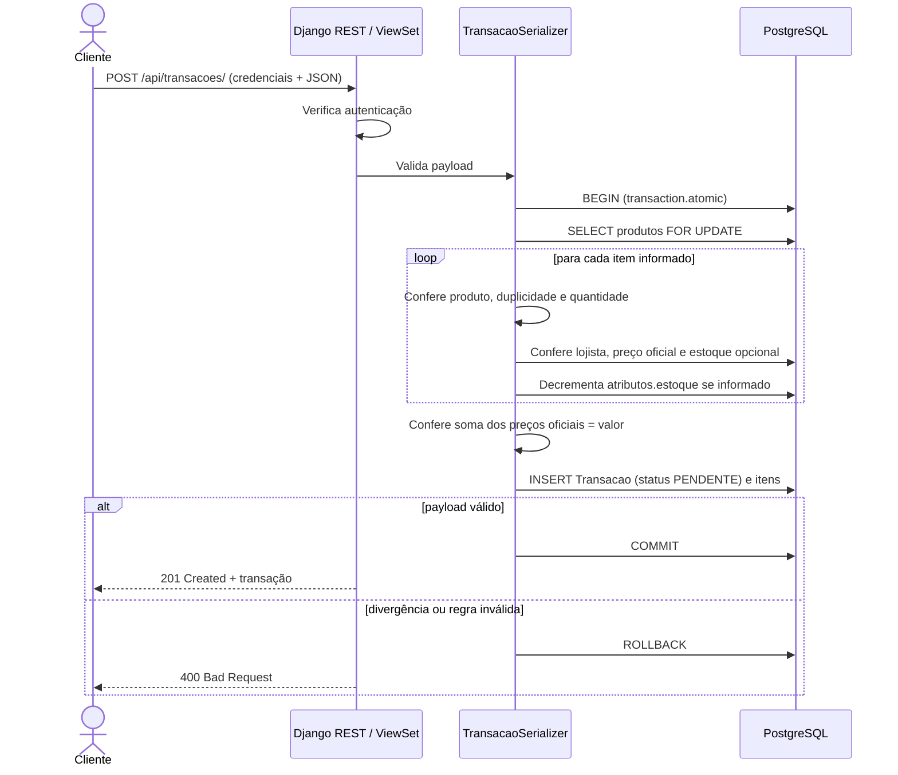
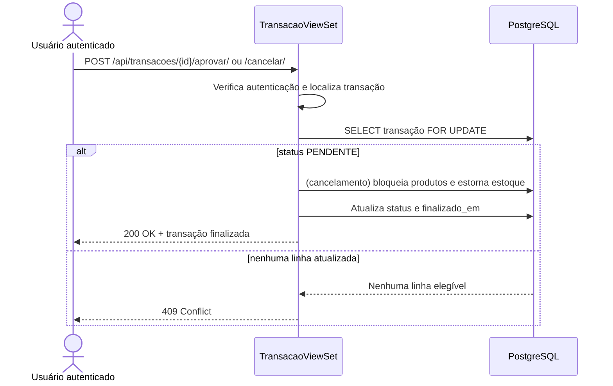
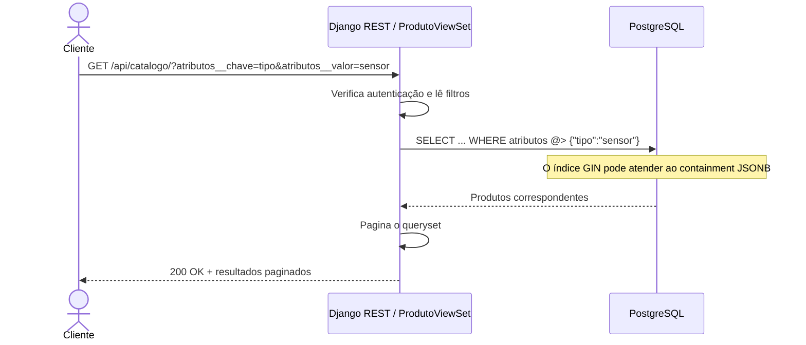
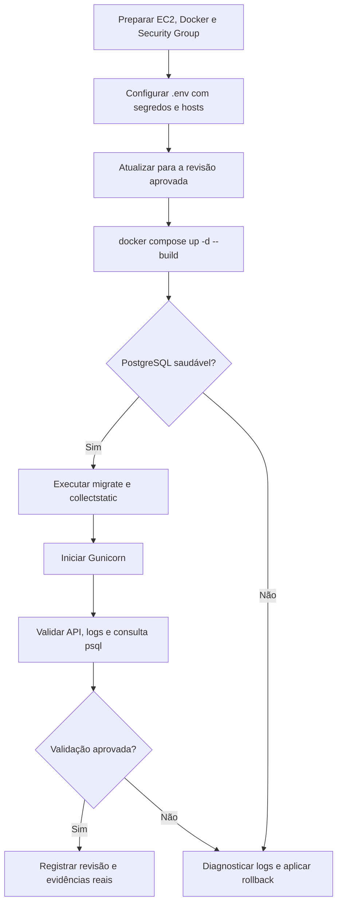

# Sequência de Comunicação — ZuumPay

## 1. Criar uma transação com itens

Fluxo baseado em `TransacaoViewSet`, `TransacaoSerializer.create()` e `ItemTransacao`. Quando a validação de domínio falha após a criação provisória, a transação atômica desfaz a transação e os itens.

Uma lista `itens: []` é rejeitada. Para compatibilidade com a baseline, payloads legados que omitem a propriedade `itens` continuam aceitos sem comparação de soma ou reserva de estoque. Produtos são vinculados a lojistas, não diretamente a lojas; a validação assegura que correspondam ao lojista da transação/loja.

## 2. Aprovar ou cancelar

O endpoint bloqueia a linha da transação dentro de `transaction.atomic()`: somente `PENDENTE -> PAGO` e `PENDENTE -> CANCELADO` são permitidas. Os estados `PAGO` e `CANCELADO` são terminais; no cancelamento, itens existentes devolvem o estoque JSON reservado.

## 3. Consulta de catálogo por atributo JSONB

O cliente autenticado consulta o endpoint de catálogo informando chave e valor. No PostgreSQL, o queryset usa containment JSONB, para o qual existe índice GIN em `Produto.atributos`, e a paginação é aplicada ao resultado.

## 4. Deploy em EC2 com Docker Compose

O Compose aguarda a saúde do PostgreSQL e inicia o serviço web; o entrypoint do serviço aplica migrações e arquivos estáticos antes de iniciar Gunicorn. A criação do superusuário é uma operação administrativa separada e não é automática.

Em caso de falha, consultar os logs antes de reverter. Fazer backup antes de migrações que alterem dados; rollback de banco só é seguro quando a migração anterior é reversível ou existe um backup restaurável.

## 5. Matriz de rastreamento

| Requisito | Caso de uso | Componente | Teste ou evidência |
|---|---|---|---|
| RF-03 — filtrar atributos JSONB | UC-03 — consultar atributos de produto | `ProdutoViewSet`, `Produto.atributos`, PostgreSQL/GIN | `test_product_json_attribute_filter_works` e `test_postgres_json_filter_uses_indexable_containment_query`; consulta manual documentada acima |
| RF-04 — criação atômica de transação | UC-04 — criar e finalizar transação | `TransacaoSerializer`, `Transacao`, `ItemTransacao` | `test_transaction_atomic_rollback_on_invalid_items` |
| RF-05 — finalização controlada | UC-04 — criar e finalizar transação | `TransacaoViewSet` | `test_transacao_status_changes_only_through_approval_or_cancellation` e `test_pending_transacao_can_be_cancelled` |
| RNF-01 — deploy e persistência | UC-05/UC-06 — implantar e recuperar dados | Docker Compose, `web`, `db`, volume PostgreSQL | `docker compose ps`, logs, acesso à API e consulta `psql`; evidências devem ser coletadas no ambiente implantado |

Os testes citados são automatizados no repositório; as verificações de infraestrutura são evidências manuais e não devem ser apresentadas como executadas até que sejam realizadas.

## 6. Histórico e aprovação

Baseline 1.0 aprovada pela Equipe ZuumPay em 2026-11-13; aprovação do orientador/avaliador pendente. Consulte o [histórico consolidado](index.md#historico-de-versoes-e-aprovacoes).
