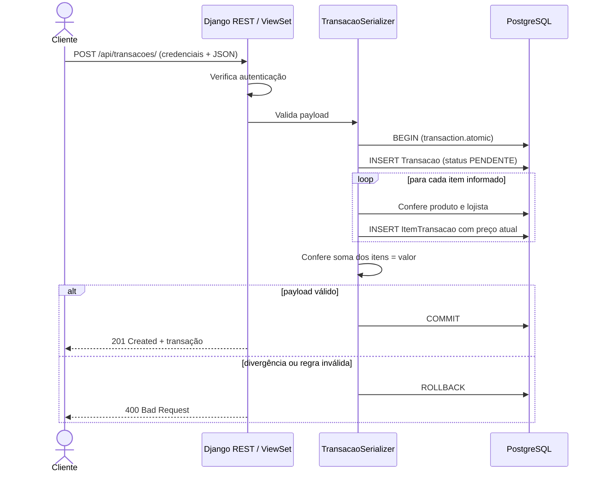
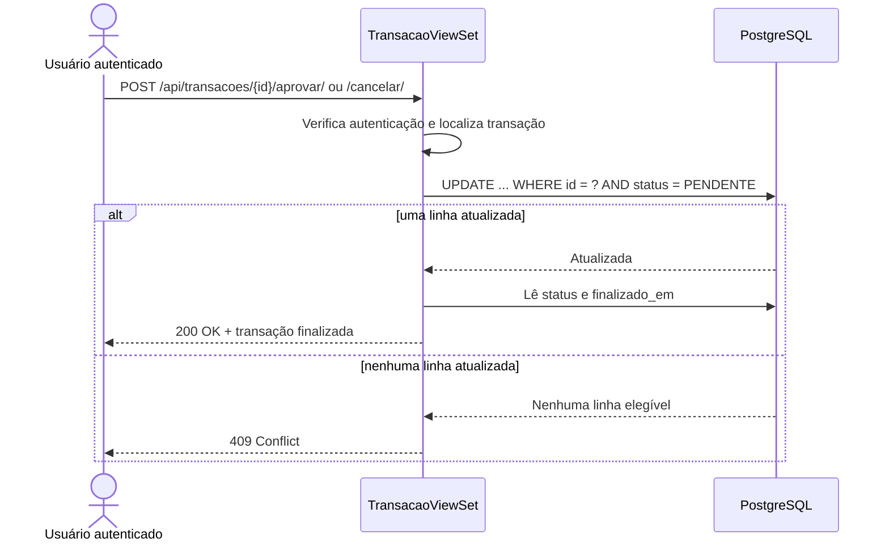

# Sequência de Comunicação — ZuumPay

## 1. Criar uma transação com itens

Fluxo baseado em `TransacaoViewSet`, `TransacaoSerializer.create()` e `ItemTransacao`. Quando a validação de domínio falha após a criação provisória, a transação atômica desfaz a transação e os itens.

Sem itens, a transação pode ser criada apenas com os dados do lojista/valor; nesse caso, a comparação com a soma dos itens não é aplicada.

## 2. Aprovar ou cancelar

O endpoint de ação realiza atualização condicional no banco: somente uma linha ainda pendente pode mudar de estado. Isso evita que uma segunda requisição finalize novamente a mesma transação.

## 3. Histórico e aprovação

Versão 1.0, preparada em 2026-11-13; aprovação do orientador/avaliador pendente. Consulte o [histórico consolidado](index.md#historico-de-versoes-e-aprovacoes).
