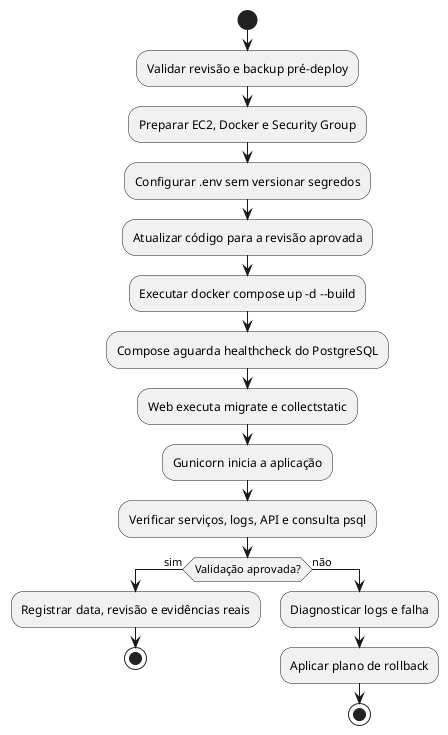

# Atividades de deploy e transição

## Objetivo
Registrar a estratégia escolhida para a implantação acadêmica em EC2, os passos operacionais, as evidências a coletar e o procedimento de rollback. O serviço atual é uma demonstração de instância única, não uma arquitetura de alta disponibilidade.

## Estratégias avaliadas

| Estratégia | Vantagens | Limitações | Decisão |
|---|---|---|---|
| EC2 + Docker Compose + PostgreSQL em volume EBS | Atende ao escopo de containerização, baixo custo de entrada e controle do ambiente | Operação, backup e recuperação são responsabilidades da equipe; instância única é ponto único de falha | **Escolhida** para a entrega acadêmica |
| EC2 + Docker Compose + AWS RDS for PostgreSQL | Banco gerenciado, backups automatizados configuráveis e opções de alta disponibilidade | Custo e configuração adicionais; exige rede privada, Security Groups e manutenção de credenciais | Alternativa para evolução futura |
| AWS Elastic Beanstalk | Plataforma gerenciada para aplicações web | Não corresponde à arquitetura/container Compose adotada nesta entrega | Não adotada |

## Diagrama de atividades do deploy



## Etapas
1. Preparar a instância EC2 com Docker e Docker Compose; restringir SSH/API no Security Group aos endereços necessários.
2. Configurar `.env` com `DJANGO_SECRET_KEY`, credenciais `POSTGRES_*` e hosts permitidos. Não adicionar o `.env` ao Git.
3. Entrar no diretório do Compose e registrar a revisão atual (`git rev-parse HEAD`). Antes de alterações de schema com risco de dados, gerar e guardar um backup fora da EC2.
4. Atualizar o código para a revisão aprovada.
5. Executar `docker compose up -d --build`. O serviço `web` aguarda a saúde do banco, aplica migrations e `collectstatic`; em seguida inicia Gunicorn. Não é necessário rodar migrations manualmente após o `up`.
6. Criar o superusuário uma única vez, se ainda não existir, com `docker compose exec web python manage.py createsuperuser`. Essa etapa é deliberadamente manual.
7. Validar `docker compose ps`, logs, `GET /api/`, `/admin/` e a consulta de verificação ao PostgreSQL.
8. Reiniciar os containers sem remover o volume e confirmar que os dados continuam persistidos.

## Estimativa de tempo e custo

- Provisionamento inicial (EC2, Security Group, Docker e configuração): aproximadamente 25 minutos, como estimativa de planejamento.
- Redeploy de uma revisão (atualizar código e rebuild): aproximadamente 2 minutos, sujeito ao tamanho da imagem e à conexão.
- Cenário de custo mensal: aproximadamente US$ 20,43 para EC2 `t3.small`, 20 GB gp3 e IPv4 público em us-east-2, conforme as premissas de [Requisitos Suplementares](../Iniciacao/rs.md#11-estimativa-de-custo-mensal). É uma estimativa, não uma cobrança observada; confirmar na AWS Pricing Calculator.

## Evidências a coletar no ambiente implantado

Registrar horário, revisão implantada e capturas reais de:

- `docker compose ps` mostrando `web` e `db` ativos/saudáveis;
- `docker compose logs --tail=100 web db` sem erros de inicialização;
- resposta HTTP 200 da API e acesso autenticado ao Admin;
- resultado da consulta no PostgreSQL:

```bash
docker compose exec db sh -c 'psql -U "$POSTGRES_USER" -d "$POSTGRES_DB" -c "SELECT id, nome, preco, atributos FROM pagamentos_produto ORDER BY id LIMIT 10;"'
```

- dado de demonstração antes/depois de reiniciar os containers, sem remover o volume.

As capturas precisam ser obtidas após executar os comandos na EC2; este documento não afirma que essas verificações já foram executadas.

## Plano de rollback

1. **Diagnóstico:** consultar `docker compose ps` e `docker compose logs --tail=200 web db`.
2. **Reversão de código:** identificar a revisão estável previamente registrada e voltar a ela no ambiente de deploy; reconstruir com `docker compose up -d --build`.
3. **Persistência:** não executar `docker compose down -v`; isso removeria o volume nomeado do PostgreSQL.
4. **Migrações:** reverter somente se a migração tiver reversão segura e compatível. Para mudanças destrutivas ou falha de restauração, interromper a aplicação e restaurar o dump previamente validado em procedimento controlado.
5. **Verificação:** confirmar saúde, logs, API e dados; registrar a revisão e o resultado do rollback.

O rollback de código não reverte automaticamente o schema nem dados. Testar backups em ambiente separado antes de depender deles para recuperação.

## Backup e restauração

Use os comandos de dump e restauração documentados em [Modelo Relacional — backup e restauração](../Elaboracao/dimrbd.md#5-procedimento-de-backup-e-restauracao). Guarde o backup fora do host e valide a restauração periodicamente.
